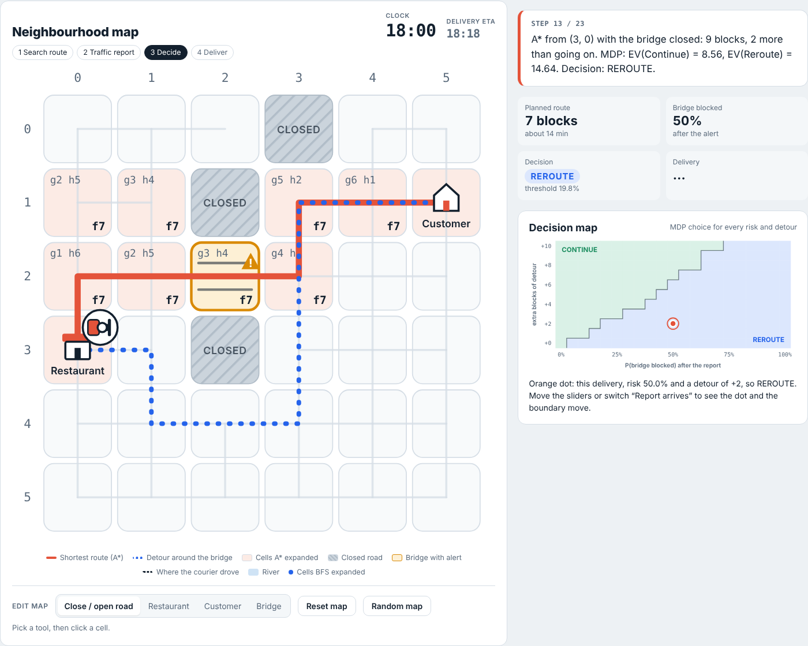
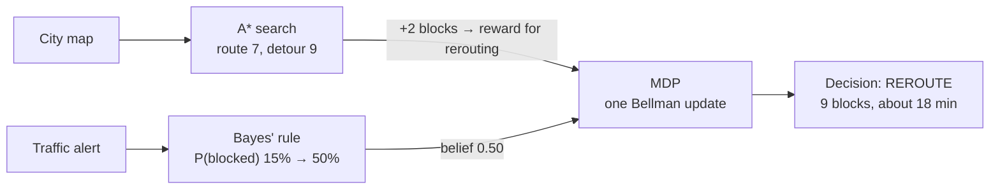
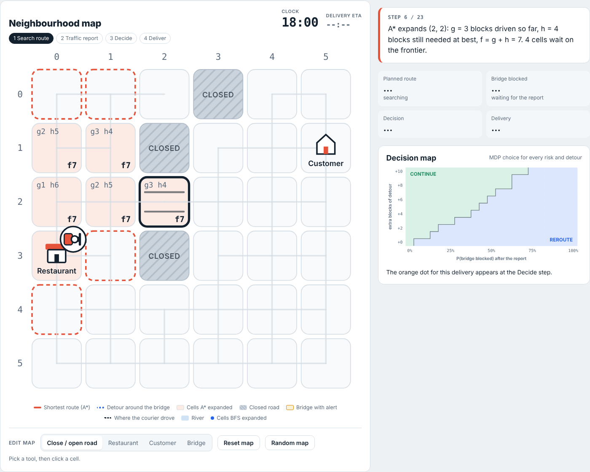
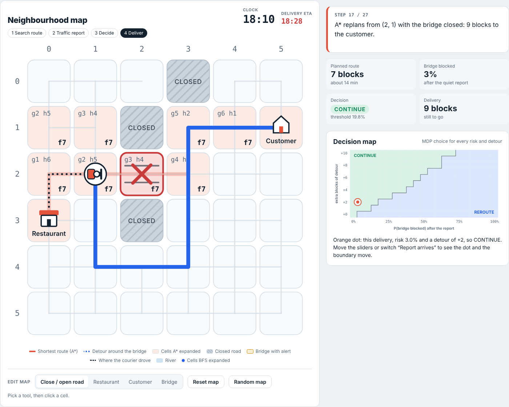
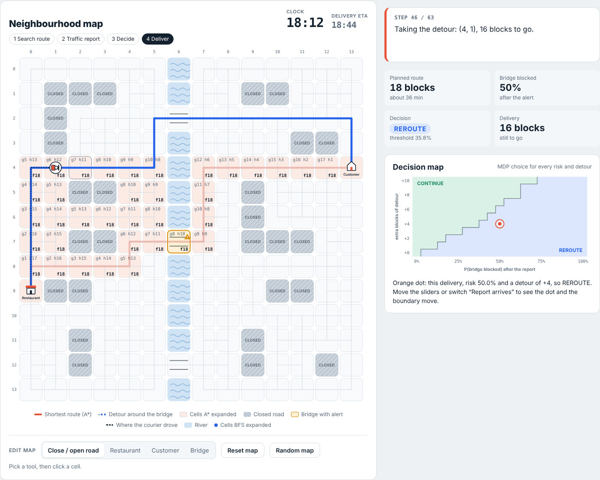
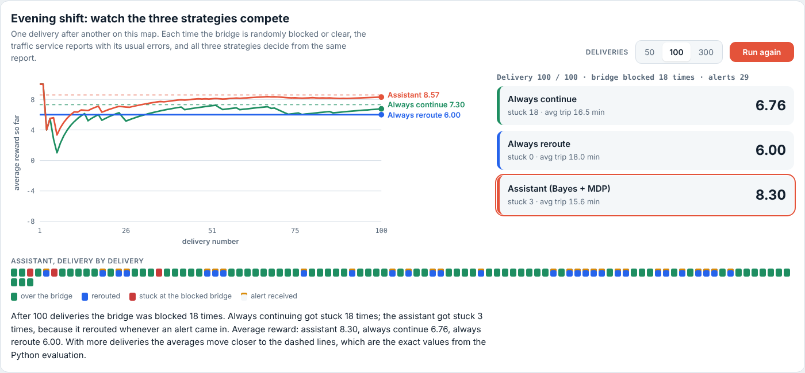

# Mini Food Delivery Assistant

**AI Fundamentals (AIF1303) · Final Project · Topic 20**

A courier takes an order from a restaurant to a customer. The shortest route
crosses a bridge, and the traffic service may report that the bridge is
blocked, but its reports are not always right. The assistant decides whether
the courier should continue over the bridge or take a detour, using three
algorithms from three different parts of the course.

**Live demo:** https://brokehustler1237.github.io/AI-Final/ (the same app is in `docs/index.html` and runs offline in any browser)



## The three AI topics

| Question | Algorithm | Course topic | Result on the 6×6 map |
|---|---|---|---|
| What is the shortest route? | **A\* search** with the Manhattan heuristic | Search and heuristics | 7 blocks over the bridge; A\* expands 10 cells, BFS 30 |
| How likely is the bridge really blocked? | **Bayesian inference** | Probability and Bayes' rule | an alert raises P(blocked) from 15% to 50% |
| Continue or reroute? | **MDP**, one Bellman update | Markov decision processes | Reroute (EV 14.64 against 8.56); reroute whenever P(blocked) > 19.8% |

The three are connected, not run side by side:



A\* is run twice: once for the shortest route and once with the bridge closed,
to find the detour. The extra length of the detour sets the reward for
rerouting in the MDP (10 − 2 × 2 = 6). Bayes' rule turns the alert into a
probability, and the MDP weights its action values by that probability.

## Running it

Python 3.8 or newer, standard library only.

```
python3 food_delivery.py                              # alert before departure
python3 food_delivery.py no_alert                     # the traffic service reports nothing
python3 food_delivery.py none                         # no report at all
python3 food_delivery.py alert --on-the-way           # the alert arrives one block before the bridge
python3 food_delivery.py no_alert --truth blocked     # courier continues, bridge really was blocked
python3 food_delivery.py --map 14x14                  # a bigger map with a river and three bridges
python3 run_tests.py                                  # all tests (or: pytest)
```

For every stage the program prints the input, the steps, the output and a
one-sentence explanation, as the project guidelines ask.

**Web app.** Open `docs/index.html`, or the live demo link. Choose the map,
the traffic report, when it arrives and whether the bridge is really blocked,
then press **Play demo** (Space pauses, → steps one frame). A caption explains
every step. Roads can be closed and the restaurant, customer and bridge moved
by clicking the map.

**Notebook.** `notebook/FoodDelivery.ipynb` runs in Google Colab (it clones
this repository first) and adds charts for every stage.

## Project structure

```
delivery/            the program
  world.py           the three maps and the map in use
  config.py          probabilities, rewards, transitions
  search.py          A* search, BFS baseline
  bayes.py           Bayesian inference about the bridge
  mdp.py             rewards, Bellman update, decision, threshold, value iteration
  planner.py         connects the three: decision from any position, trip simulation,
                     decision map, evaluation of three policies
  report.py          console output for every stage
  cli.py             command line
food_delivery.py     entry point
tests/               52 tests
run_tests.py         runs the tests without pytest
app/                 sources of the web app (template, algorithms, interface) + build script
  check_app.py       checks that the web app computes the same results as Python
docs/                web app (GitHub Pages), screenshots, report, slides, declarations
notebook/            Colab notebook with charts
```

## Inputs

All values are assumptions for the demonstration, as the project brief allows.

| Parameter | Value |
|---|---|
| Map | 6×6, 3 closed cells, restaurant (3, 0), customer (1, 5), bridge (2, 2) |
| Prior P(bridge blocked) | 0.15 |
| P(alert \| blocked) / P(alert \| clear) | 0.85 / 0.15 |
| MDP states / actions | Clear, Blocked / Continue, Reroute |
| Rewards | on time +10, stuck at the bridge −8, reroute 10 − 2 × extra blocks |
| Transitions | Clear → Clear 0.9 (either action); Blocked + Continue → Blocked 0.7; Blocked + Reroute → Clear 0.9 |
| Discount γ | 0.9 |

## Results

| Traffic report | P(blocked) | Decision | Bridge clear | Bridge blocked |
|---|---|---|---|---|
| Alert before departure | 0.50 | Reroute | 18 min | 18 min |
| Alert on the way | 0.50 | Reroute | 22 min | 22 min |
| No alert | 0.03 | Continue | 14 min | 28 min (6 min stuck) |
| No report | 0.15 | Continue | 14 min | 28 min (6 min stuck) |

**Is the assistant actually better?** 10,000 simulated evening deliveries,
with the bridge blocked at random and the alert service making its usual
errors:

| Policy | Average reward | Stuck at the bridge | Rerouted |
|---|---|---|---|
| Always continue | 7.30 | 15.0% | 0% |
| Always reroute | 6.00 | 0% | 100% |
| **Assistant (Bayes + MDP)** | **8.57** | **2.3%** | 25.5% |

**Bigger maps.** The same algorithms on maps with a river and several bridges:

| Map | Route | A\* expands | BFS expands | Alert before departure | Alert on the way |
|---|---|---|---|---|---|
| 6×6 | 7 | 10 | 30 | +2 blocks, reroute | +4 blocks, reroute |
| 10×10 | 16 | 28 | 78 | +2 blocks, reroute | +12 blocks, **continue** |
| 14×14 | 18 | 37 | 140 | +4 blocks, reroute | +4 blocks, reroute |

On 10×10 the same alert leads to opposite decisions: before departure the
other bridge is close, but once the courier is next to the first bridge,
turning back costs 12 extra blocks.

## Testing

`python3 run_tests.py` or `pytest` runs 52 tests. Each result is checked with a
method different from the one the program uses:

- **A\*:** the route is valid and as short as a plain BFS; the heuristic is
  admissible at every open cell of every map; no route is returned when the
  customer is walled in; BFS finds the same length but expands 30 cells.
- **Bayes:** the posterior equals exact fractions (P(blocked | alert) is exactly 1/2).
- **MDP:** the four Q values match the hand calculation; one Bellman update gives
  the same policy as full value iteration for every detour length from 0 to 10;
  at the threshold both actions are worth the same; a 7-block detour flips the
  decision.
- **Together:** the decisions for each report, the replanning when the alert
  arrives on the way, the delivery times above, the shape of the decision map,
  and the assistant beating both simple policies.
- **Command line:** all 36 combinations of map, report, timing and true bridge
  state run end to end.

`python3 app/check_app.py` (needs Node.js) confirms the web app computes the same
routes, A\* expansion order, decisions and delivery times as the Python
program on all three maps and all 12 scenarios of each.

## Screenshots

| A\* search in progress | Stuck at a blocked bridge, A\* replans |
|---|---|
|  |  |

| 14×14 map with a river | Evening shift: three policies compete |
|---|---|
|  |  |

## Limitations

- All probabilities and rewards are assumed; a real system would estimate them
  from traffic history and past deliveries.
- The alert concerns one bridge. Many road segments whose state changes over
  time would need a Bayesian network or a hidden Markov model.
- Every block has the same length; A\* handles weighted roads directly.
- The transition table is fixed; it could be learned from past deliveries with
  Q-learning.

## Documents

- [Technical report](docs/TECHNICAL_REPORT.md)
- [Presentation](docs/presentation.pdf)
- [Demo video](docs/demo.mp4)
- [AI usage declaration](docs/AI_USAGE_DECLARATION.md)
- [Team contribution statement](docs/TEAM_CONTRIBUTION.md)
