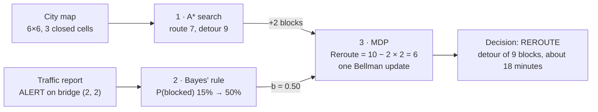
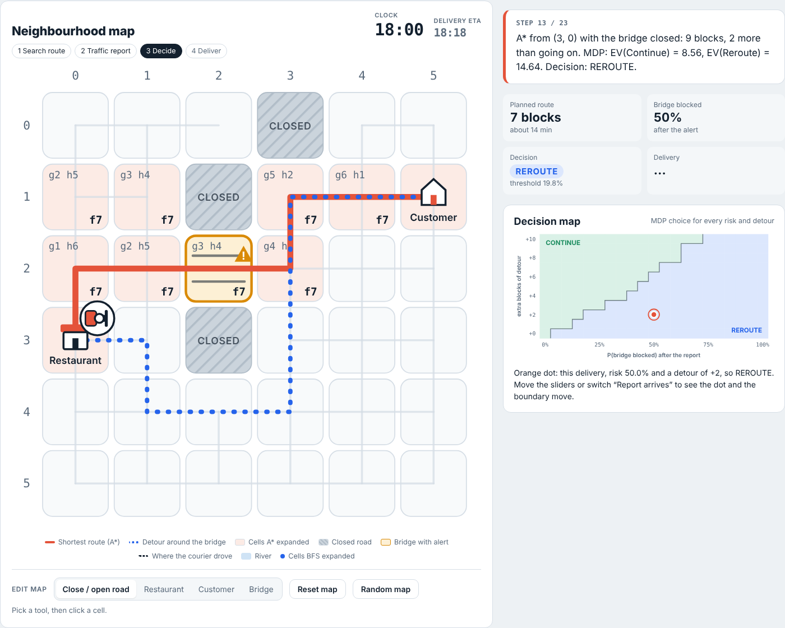
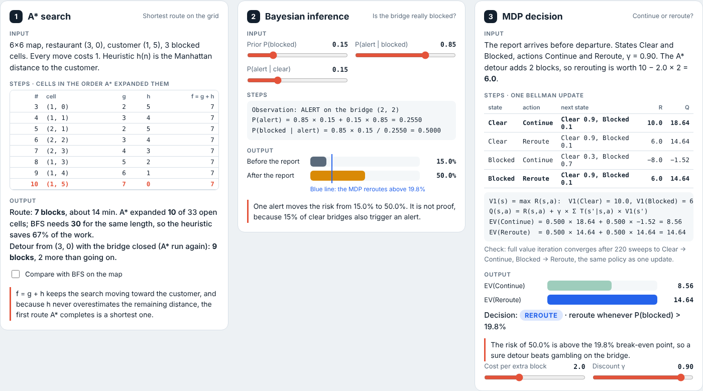
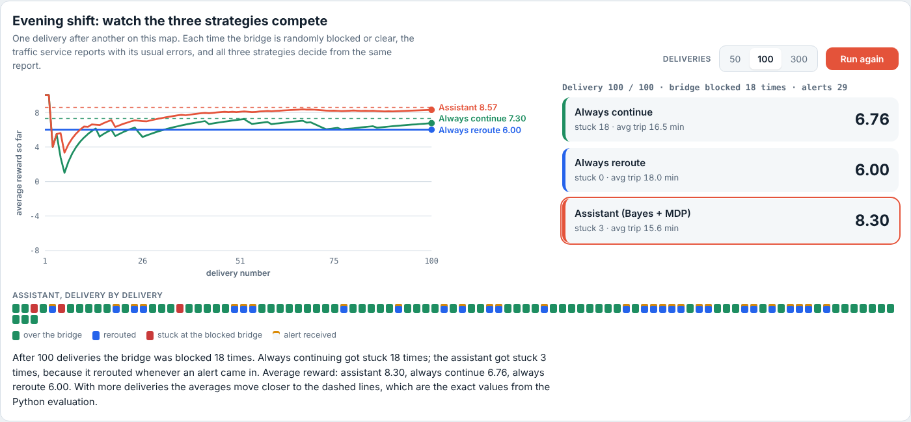

# Mini Food Delivery Assistant — Technical Report

**AI Fundamentals (AIF1303) · Final Project · Topic 20** · Repository: [github.com/brokehustler1237/AI-Final](https://github.com/brokehustler1237/AI-Final) · Insar · November 2026

## 1. Summary

The Mini Food Delivery Assistant decides whether a courier should cross a bridge that may be blocked or take a detour. It combines three algorithms from three topics of the course: **A\* search** finds the shortest route and the detour, **Bayesian inference** turns an unreliable traffic alert into a probability that the bridge is blocked, and a **Markov decision process** compares the two actions using one Bellman update weighted by that probability.

On the 6×6 map from the project brief, an alert raises P(blocked) from 15% to 50%, and the assistant reroutes (expected value 14.64 against 8.56). Over 10,000 simulated deliveries it gets stuck at the bridge in **2.3%** of cases against **15.0%** for a courier who always continues, and earns the highest average reward of the three policies tested (8.57 against 7.30 and 6.00).

The system is a Python package with a command-line program, an interactive web app that runs the same algorithms, and a Colab notebook. 52 automated tests check every result with an independent method, and a separate script confirms that the web app computes exactly what the Python program computes.

## 2. Problem statement and objectives

Food delivery is judged by minutes. A courier on the shortest route can lose much more time than a detour would cost if a road on that route turns out to be blocked, but taking every detour "just in case" makes every delivery slower. Traffic services help, yet their alerts are imperfect: some blockages are missed and some alerts are false alarms. The courier, or the app guiding the courier, has to make a decision under uncertainty, often at the last moment.

The project models this as a small, controlled scenario. A courier carries an order from a restaurant to a customer across a grid neighbourhood. The shortest route crosses a bridge. Before departure, or while the courier is already driving, the traffic service may send an alert about the bridge. The assistant must decide whether to continue over the bridge or reroute.

**Objectives**

1. Find the shortest route, and the shortest route that avoids the bridge, with an optimal and efficient search (A\*).
2. Convert the traffic report into a calibrated probability that the bridge is blocked, taking the reliability of the alert service into account (Bayesian inference).
3. Choose between continuing and rerouting by weighing the certain cost of the detour against the risk of getting stuck, including what happens after the decision (MDP).
4. Connect the three so that each algorithm uses the output of the previous one.
5. Show that the decisions are better than simple fixed rules, with tests and a simulation.
6. Make every step visible: in the console as input, steps, output and explanation, and in an interactive app.

All probabilities, rewards and maps are assumptions made for the demonstration, as the project guidelines allow. Topic 20 of the course list specifies a 6×6 grid with 3 blocked cells, two road states and two actions; that map is the default, and two larger maps are added as extra scenarios.

## 3. System overview

The three algorithms form a pipeline rather than three separate demonstrations. A\* supplies the price of the detour, which becomes the reward for rerouting; Bayes' rule supplies the belief with which the MDP weights its action values. Without either input the MDP cannot decide, and without the MDP the route and the probability do not produce an action.

## 4. Algorithm 1: A\* search

**Formulation.** The neighbourhood is a grid. A state is a cell (row, column); the actions are moves up, right, down and left into an open cell; every move costs 1 block (2 minutes). The start is the restaurant and the goal is the customer. Closed cells (construction, buildings and, on the larger maps, the river) cannot be entered.

**Method.** A\* keeps a priority queue (frontier) ordered by

$$f(n) = g(n) + h(n)$$

where g(n) is the number of blocks driven from the restaurant to n, and h(n) is the Manhattan distance from n to the customer, |r − r_goal| + |c − c_goal|. It repeatedly expands the cell with the smallest f, adds its open neighbours to the frontier, and stops when the customer is taken off the frontier. Ties in f are broken by the smaller h, then by insertion order, so the search is deterministic and the Python program and the web app expand cells in exactly the same order.

**Admissibility.** With moves only in four directions and a cost of at least 1 per move, each move reduces the Manhattan distance by at most 1, and obstacles can only make the true path longer. So h(n) never overestimates the remaining cost. An admissible heuristic guarantees that A\* returns a shortest path. The test suite checks h(n) ≤ true distance at every open cell of all three maps.

**Two searches.** A\* runs once for the shortest route and once more with the bridge treated as closed, to obtain the detour. When the alert arrives on the way, the second search starts from the courier's current cell. The difference in length becomes the cost of rerouting in the MDP.

**Results.**

| Map | Shortest route | Detour | A\* expanded | BFS expanded |
| --- | --- | --- | --- | --- |
| 6×6 (brief) | 7 blocks | 9 blocks | 10 | 30 |
| 10×10 | 16 blocks | 18 blocks | 28 | 78 |
| 14×14 | 18 blocks | 22 blocks | 37 | 140 |

Breadth-first search also finds a shortest route here, because all moves cost the same, but it spreads in every direction. A\* reaches the same length with 3 to 4 times fewer expansions. On the 6×6 map every expanded cell has f = 7, which means a path exists whose length equals the Manhattan distance, and A\* follows it almost directly.

## 5. Algorithm 2: Bayesian inference

**Model.** The hidden variable is whether the bridge is blocked. The evidence is the report of the traffic service: ALERT, NO ALERT, or no report at all.

| Quantity | Value | Meaning |
| --- | --- | --- |
| P(blocked) | 0.15 | prior: the bridge is blocked on 15% of evening rush hours |
| P(alert \| blocked) | 0.85 | the service reports 85% of real blockages |
| P(alert \| clear) | 0.15 | it sends a false alarm on 15% of clear evenings |

**Calculation.** Bayes' rule gives the posterior:

$$P(\text{blocked} \mid \text{alert}) = \frac{P(\text{alert} \mid \text{blocked})\,P(\text{blocked})}{P(\text{alert} \mid \text{blocked})\,P(\text{blocked}) + P(\text{alert} \mid \text{clear})\,P(\text{clear})}$$

- P(alert) = 0.85 × 0.15 + 0.15 × 0.85 = 0.255
- P(blocked | alert) = 0.1275 / 0.255 = **0.50**

| Report | P(blocked) after the report |
| --- | --- |
| ALERT | 0.500 |
| NO ALERT | 0.030 (0.0225 / 0.745) |
| No report | 0.150, the prior |

**Base-rate effect.** Although the service catches 85% of blockages, one alert only brings the risk to 50%. Out of 100 evenings, about 12.75 alerts come from real blockages (15 × 0.85) and about 12.75 are false alarms (85 × 0.15), because clear evenings are far more common. Treating the alert as certain would make the courier take the detour on every false alarm. The posterior is the belief that the MDP uses in the next step.

**Verification.** The test suite recomputes all three posteriors in exact rational arithmetic (P(blocked | alert) is exactly 1/2) and compares them with the program's floating-point results.

## 6. Algorithm 3: Markov decision process

**Model.**

- States: **Clear** and **Blocked** (the bridge).
- Actions: **Continue** over the bridge and **Reroute** along the A\* detour.
- Discount factor γ = 0.9.
- Rewards R(s, a): +10 for an on-time delivery, −8 for getting stuck at a blocked bridge, and 10 − 2 × (extra blocks) for the detour. With the 2 extra blocks found by A\*, rerouting is worth 6 in either state.

| State | Action | Next state | R |
| --- | --- | --- | --- |
| Clear | Continue | Clear 0.9, Blocked 0.1 | +10 |
| Clear | Reroute | Clear 0.9, Blocked 0.1 | +6 |
| Blocked | Continue | Clear 0.3, Blocked 0.7 | −8 |
| Blocked | Reroute | Clear 0.9, Blocked 0.1 | +6 |

A blocked bridge usually stays blocked while the courier waits (0.7); on the detour the road ahead is usually clear (0.9).

**One Bellman update.** Starting from V₀ = 0, the first sweep gives V₁(s) = maxₐ R(s, a): V₁(Clear) = 10 and V₁(Blocked) = 6. One Bellman backup then gives the action values:

$$Q(s, a) = R(s, a) + \gamma \sum_{s'} T(s' \mid s, a)\, V_1(s')$$

| | Continue | Reroute |
| --- | --- | --- |
| **Clear** | 10 + 0.9 × (0.9 × 10 + 0.1 × 6) = **18.64** | 6 + 0.9 × 9.6 = 14.64 |
| **Blocked** | −8 + 0.9 × (0.3 × 10 + 0.7 × 6) = −1.52 | 6 + 0.9 × 9.6 = **14.64** |

**Decision under uncertainty.** The assistant does not observe the state, only the Bayes posterior b = P(blocked). Each action is scored by its expected value:

$$EV(a) = (1 - b)\, Q(\text{Clear}, a) + b\, Q(\text{Blocked}, a)$$

With b = 0.5: EV(Continue) = 8.56 and EV(Reroute) = 14.64, so the assistant **reroutes**.

**Break-even risk.** Continue is better by 4 in Clear; Reroute is better by 16.16 in Blocked. The two actions are worth the same at b = 4 / (4 + 16.16) = **0.198**. Above a 19.8% risk the assistant reroutes, so an alert (50%) leads to Reroute, while no alert (3%) or no report (15%) leads to Continue.

**Effect of timing.** If the alert arrives when the courier is already one block before the bridge, A\* finds a detour 4 blocks longer instead of 2. The reroute reward drops to 2 and the threshold rises to 35.8%. On the 10×10 map the detour from that point is 12 blocks longer, the threshold is 86.6%, and the same alert leads to Continue: it is too late to turn back.

**Check against full value iteration.** The brief asks for one Bellman update. To confirm that one update is enough here, the program also runs value iteration to convergence (about 220 sweeps); it gives the same policy (Clear → Continue, Blocked → Reroute) for every detour length from 0 to 10 blocks.

## 7. Implementation

The program is written in Python 3 with the standard library only. It is organised as a package, one module per responsibility:

| Module | Responsibility |
| --- | --- |
| `delivery/world.py` | the three maps (6×6, 10×10, 14×14) and the map in use |
| `delivery/config.py` | probabilities, rewards, transitions, discount factor |
| `delivery/search.py` | A\* search (heap-based priority queue) and BFS as a baseline |
| `delivery/bayes.py` | Bayes' rule for the three possible reports |
| `delivery/mdp.py` | rewards from the detour length, Bellman update, expected values, break-even threshold, value iteration |
| `delivery/planner.py` | connects the three: the decision from any position, the trip simulation, the decision map, the evaluation of three policies |
| `delivery/report.py` | console output: input, steps, output and explanation for every stage |
| `delivery/cli.py`, `food_delivery.py` | command line: report, timing, true bridge state, map |

`planner.decide_at(position, remaining, report)` is the core of the integration: it runs A\* from the courier's position with the bridge closed, computes the reroute reward from the extra length, gets the belief from Bayes' rule, performs the Bellman update and returns the action.

**Web app.** The same algorithms are implemented in JavaScript (`app/logic.js`) and drive an interactive page (`app/ui.js`, `app/template.html`), built into a single file, `docs/index.html`, that runs offline and is published with GitHub Pages. `app/check_app.py` runs both implementations on all three maps and 12 scenarios each and confirms identical routes, A\* expansion order, decisions and delivery times.

**Notebook.** `notebook/FoodDelivery.ipynb` runs in Google Colab, imports the package and adds charts: the A\* and BFS expansions, the prior and posterior, the expected values of both actions, the decision map and the evaluation.

## 8. Testing and results

### Test suite

52 tests pass with `python3 run_tests.py` or `pytest`. Each result is checked with a method different from the one the program uses, so an error in one is not repeated in the other.

| Area | What is checked | Independent method |
| --- | --- | --- |
| A\* search | route is valid and shortest; detour avoids the bridge; no route when the customer is walled in | breadth-first search |
| Heuristic | h(n) ≤ true distance at every open cell, on all three maps | BFS distance from every cell |
| Bayes | posteriors for ALERT, NO ALERT and no report | exact rational arithmetic |
| MDP | the four Q values; threshold is the break-even point; a 7-block detour flips the decision | hand calculation |
| MDP policy | one Bellman update gives the same policy as full value iteration, detours 0–10 | value iteration to convergence |
| Integration | decisions per report; replanning on the way; trip times; decision map is monotone | expected values worked out by hand |
| Evaluation | the assistant beats both fixed policies; simulation agrees with the exact expectation | exact expectation over all outcomes |
| Stability | the command line runs end to end on all 36 combinations of map, report, timing and true bridge state | — |

In addition, `app/check_app.py` confirms that the web app and the Python program agree on all 3 maps × 12 scenarios.

### Scenarios on the 6×6 map

The assistant never sees whether the bridge is really blocked; the true state only decides what happens on the road.

| Report | P(blocked) | Decision | Bridge clear | Bridge blocked |
| --- | --- | --- | --- | --- |
| Alert before departure | 0.50 | Reroute | 18 min | 18 min |
| Alert on the way | 0.50 | Reroute | 22 min | 22 min |
| No alert | 0.03 | Continue | 14 min | 28 min (6 min stuck, A\* replans) |
| No report | 0.15 | Continue | 14 min | 28 min (6 min stuck, A\* replans) |

### Is the assistant better than simple rules?

10,000 simulated evening deliveries. In each, the bridge is blocked with probability 0.15, the alert service reports with its error rates, and each policy decides from the same report. Exact expected values are computed alongside the simulation.

| Policy | Average reward (exact) | Simulated | Stuck at the bridge | Rerouted |
| --- | --- | --- | --- | --- |
| Always continue | 7.30 | 7.29 | 15.0% | 0% |
| Always reroute | 6.00 | 6.00 | 0% | 100% |
| **Assistant (Bayes + MDP)** | **8.57** | **8.57** | **2.3%** | 25.5% |

The assistant reroutes only when an alert arrives, a quarter of the time, and still avoids almost all blockages. The remaining 2.3% are the cases where the bridge is blocked and no alert comes (0.15 × 0.15 = 0.0225), which no policy based on the report can avoid.

### Larger maps

| Map | Alert before departure | Alert on the way |
| --- | --- | --- |
| 6×6 | detour +2, Reroute (threshold 19.8%) | detour +4, Reroute (threshold 35.8%) |
| 10×10 | detour +2, Reroute (threshold 19.8%) | detour +12, **Continue** (threshold 86.6%) |
| 14×14 | detour +4, Reroute (threshold 35.8%) | detour +4, Reroute (threshold 35.8%) |

The 10×10 case shows the value of combining search with decision-making: the same alert leads to opposite decisions depending on where the courier is when it arrives.

## 9. User interface and user experience

The project has two interfaces for two audiences.

**Console program.** For every stage it prints the input, the steps (for A\*, the full expansion table with g, h and f; for Bayes and the MDP, every calculation with numbers), the output, and a one-sentence explanation, as the project guidelines ask. Command-line options select the report, its timing, the true state of the bridge and the map.

**Interactive web app** (`docs/index.html`, also at the GitHub Pages link). It is designed so that someone who has never seen the algorithms can follow a delivery:

- **The map is the main element.** A\* fills in cells as it expands them, with g, h and f on each, and the frontier outlined. The route, the detour, the courier and the path actually driven are drawn on the map.
- **Narration.** A caption next to the map explains every step in plain words with the actual numbers, and a step counter shows progress. The demo can be played, paused (Space), stepped (→) or skipped to the result, at three speeds.
- **Three algorithm cards** show input, steps and output for A\* (with a scrollable expansion table), Bayes (with the calculation and prior-versus-posterior bars) and the MDP (with the Q table, the expected values and the decision).
- **What-if controls.** The report, its timing, the true bridge state, the map size and the model parameters (prior, alert reliability, detour cost, γ) can be changed; everything is recomputed immediately. Roads can be closed and the restaurant, customer and bridge moved by clicking the map, or a random map generated.
- **Decision map.** A chart of the MDP decision for every risk and detour length, with the current delivery marked, shows where the decision flips.
- **Evening shift.** 50, 100 or 300 deliveries played in a row, with a live chart of the three policies' average reward converging to the exact values, a scoreboard and a ribbon showing each delivery's outcome.
- **Clock and ETA.** A clock starting at 18:00 and the estimated delivery time make the cost of each decision concrete; the ETA turns red when the courier gets stuck.

The page works in light and dark themes, on narrow screens, without an internet connection, and respects the reduced-motion setting.

*The decision step on the 6×6 map: A\* expansion with g, h and f, the route and the detour, the narration, and the decision map with this delivery marked.*

*The three algorithm cards, each with input, steps and output.*

*Evening shift: the three policies over 100 deliveries; dashed lines are the exact expected values.*

## 10. Limitations and future work

| Limitation | Effect | Possible improvement |
| --- | --- | --- |
| All probabilities and rewards are assumed | results show the method, not real delivery times | estimate the prior and the alert reliability from traffic history, and rewards from real delivery times |
| One bridge, one report | real cities have many roads whose state changes during a trip | a Bayesian network over road segments, or a hidden Markov model that tracks each road over time |
| Every block has the same length | real roads differ in length and speed | weighted edges; A\* handles them directly, with distance divided by the top speed as an admissible heuristic |
| Fixed transition table | how long blockages last is guessed | learn the transitions, or the Q values directly with Q-learning, from past deliveries |
| One courier, one order | no batching or competition for roads | multi-agent routing and order assignment |

## 11. Conclusion

The project shows how three course topics solve one practical problem together. A\* provides the routes and, by being run a second time with the bridge closed, the price of avoiding it. Bayesian inference turns an imperfect alert into a realistic probability, which matters because blockages are rare and false alarms are common. The MDP combines the two into a decision that accounts for what happens after it is made. The resulting assistant reroutes only when the risk justifies the detour, avoids 85% of the blockages a naive courier would hit, and achieves the highest average reward of the policies tested. Every result is reproducible from the repository and checked by independent tests.

## 12. AI usage declaration and team contribution

### AI usage declaration

| Field | Declaration |
| --- | --- |
| AI tool | Claude (Anthropic), used through the Claude app, November 2026 |
| Purpose of use | Generating the Python and JavaScript code, writing tests, debugging, and drafting the README, this report, the slides and defence notes |
| How it was used | I chose topic 20 from the course list and gave the requirements from the project brief and the topic description. I worked with the assistant over several iterations, each time deciding what to change next: a visual interactive version instead of a console-only program, a narrated step-by-step demo, an alert that can arrive while the courier is driving, a check of what really happened on the road, larger maps with a river, and a live simulation of many deliveries. The code and document drafts were generated by the assistant according to these instructions. |
| What I did myself | Chose the topic and the scope; defined and changed the requirements across iterations; ran the program, the tests and the web app; reviewed the results and the explanations of A\*, Bayesian inference and the MDP; prepared and rehearsed the defence. |
| Verification | The 52 tests and `app/check_app.py` described in section 8. I re-did the key calculations by hand: P(blocked \| alert) = 0.85 × 0.15 / 0.255 = 0.50, and the break-even risk 4 / 20.16 = 19.8%. |
| Student statement | I confirm that I am responsible for the final work, that I understand and can explain every part of it, and that I have accurately disclosed my use of AI. |

### Team contribution statement

This is an individual project; all roles were carried out by one student.

| Member | Role | Contribution | Share |
| --- | --- | --- | --- |
| Insar *(full name, student ID)* | Sole member | problem definition and scope; design of the A\* → Bayes → MDP pipeline; Python package and web app; testing and evaluation; report, slides, demo video; defence | 100% |

### References

- S. Russell, P. Norvig, *Artificial Intelligence: A Modern Approach*, 4th ed.: A\* search and admissible heuristics (ch. 3), Bayes' rule (ch. 12), Markov decision processes and value iteration (ch. 17).
- AI Fundamentals (AIF1303) course materials and the Final Project topic list (topic 20, Mini Food Delivery Assistant).
